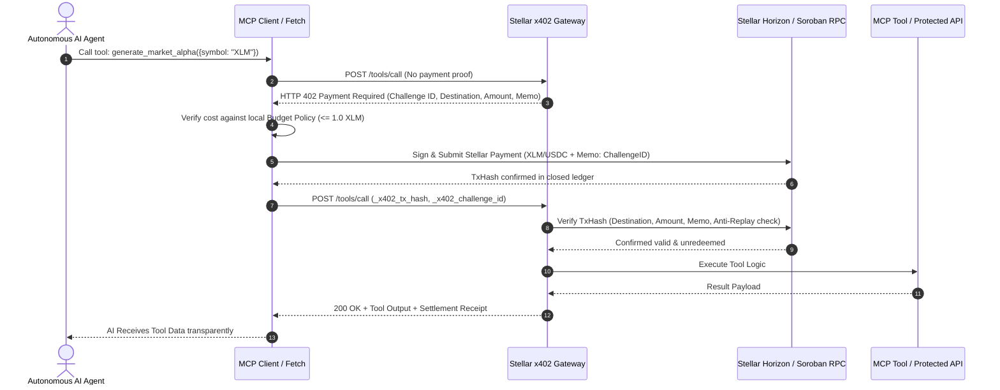

# `stellar-x402-mcp`

> **Stellar Agent Gateway & HTTP 402 Micropayment Facilitator for Model Context Protocol (MCP)**

[](https://github.com/camesenin/stellar-x402-mcp/actions/workflows/ci.yml)
[](https://opensource.org/licenses/Apache-2.0)
[](https://soroban.stellar.org/)
[](https://modelcontextprotocol.io/)

Autonomous AI agents (running on Claude Desktop, Cursor, Antigravity, or custom LLM frameworks) cannot easily use traditional credit cards or monthly SaaS subscriptions to pay for API resources, live compute, and agent tools. 

`stellar-x402-mcp` is developer infrastructure that brings machine-to-machine micropayments to life using **HTTP 402 Payment Required** and **Stellar / Soroban**.

---

## ⚡ Why Stellar for Autonomous Agent Payments?

| Feature | Stellar / Soroban | Ethereum L1 / L2 | Credit Cards / Stripe |
| :--- | :--- | :--- | :--- |
| **Transaction Cost** | **~$0.00001 (100 stroops)** | $0.05 – $5.00+ | $0.30 + 2.9% minimum |
| **Settlement Finality** | **3 – 5 seconds** | 12s – 15m | 2 – 3 business days |
| **Native Anti-Replay** | **Ledger Memos & Soroban Nonces** | Calldata inspection | Manual authorization ID |
| **Micro-denomination** | **Sub-cent fractions viable** | Impractical due to gas | $0.50 minimum charge |
| **Zero-KYC Machine Auth** | **Native Keypairs** | Smart Accounts / Bundlers | Requires corporate entity |

---

## 🏗️ Architecture



---

## 📦 Monorepo Structure

```
stellar-x402-mcp/
├── packages/
│   ├── contracts/   # Soroban Rust smart contract (ReceiptVault with anti-replay)
│   ├── gateway/     # Express middleware & MCP Server with 402 enforcement
│   ├── client/      # Autonomous Agent SDK with automated 402 budget negotiation
│   └── cli/         # `x402-stellar` CLI: keygen, gateway, verify, pay
├── examples/
│   └── mcp-payment-demo/ # Full end-to-end runnable agent payment simulation
└── .github/workflows/ci.yml # Continuous Integration (Contracts + TS)
```

---

## 🚀 Quickstart

### 1. Installation

```bash
git clone https://github.com/camesenin/stellar-x402-mcp.git
cd stellar-x402-mcp
pnpm install
pnpm build
```

### 2. Generate and Fund Agent Keypair (Testnet)

```bash
pnpm --filter @stellar-x402/cli run build
node packages/cli/dist/bin.js keygen --fund
```

Output:
```
✨ New Stellar Keypair Generated:
Public Key:  GAUTONOMOUS...
Secret Key:  SSECRETKEY...
✓ Friendbot funded account successfully with 10,000 XLM!
```

### 3. Run the x402 Gateway

Start an HTTP & MCP gateway protecting resources with a fee of `0.01 XLM`:

```bash
node packages/cli/dist/bin.js gateway \
  --port 3402 \
  --dest GA25XQA6A4QGWU566XN6ZCFW3OFH55YOOXWXUYUL2FJ5SO2R6GCCSVKV \
  --amount 0.01 \
  --network testnet
```

### 4. Use the Client in Your Agent Code

```typescript
import { createX402Fetch, ClientConfig } from '@stellar-x402/client';

const config: ClientConfig = {
  secretKey: process.env.STELLAR_AGENT_SECRET!,
  network: 'testnet',
  maxPaymentPerCallXlm: 0.5, // Safety ceiling per call
  totalBudgetLimitXlm: 10.0, // Maximum total spend
};

// Drop-in fetch replacement with automatic Stellar 402 payment handling
const agentFetch = createX402Fetch(config);

// First call gets 402, automatically signs payment, and returns 200 payload
const response = await agentFetch('http://localhost:3402/api/protected-intel');
const data = await response.json();
console.log('Result:', data);
```

### 5. Run the MCP Tool Payment Demo

```bash
pnpm --filter mcp-payment-demo test
```

---

## 🔒 Deployed Soroban Smart Contract (`X402PaymentVault`)

The repository includes a compiled and **on-chain deployed Soroban smart contract** on Stellar Testnet designed for verifiable audit trails and atomic token transfers:

- **Network**: Stellar Testnet
- **Contract ID**: [`CDCTANWGJPZ3YUYAP7NGS4ZHESA37YJEEQCHOOTINTVINOFNO5G24NIA`](https://stellar.expert/explorer/testnet/contract/CDCTANWGJPZ3YUYAP7NGS4ZHESA37YJEEQCHOOTINTVINOFNO5G24NIA)
- **Wasm Hash**: `a3e512cc196ff88ac2e2df83b19bac5415b9a89a569f03a881f65b5a4d91fbd5`
- **Instantiation Ledger**: `5526238` (TxHash: `ae152d8104b4e4b8bd100498f7e6245cbd68aecea88eaf5f165f4fc4f7a6e7be`)
- **Verified Settlement Tx**: [`258669e717a07c8f07addd388ffc9599daa24492c42422031b5c0b462e930874`](https://stellar.expert/explorer/testnet/tx/258669e717a07c8f07addd388ffc9599daa24492c42422031b5c0b462e930874) (Ledger `5526606`)

### Contract Functions:
- `settle_payment(env, payer, recipient, token, amount, challenge_hash) -> Result<PaymentReceipt, X402Error>`
- `is_settled(env, challenge_hash) -> bool`
- `get_receipt(env, challenge_hash) -> Result<PaymentReceipt, X402Error>`
- `total_settlements(env) -> u64`
- **Features**:
  - Cryptographic anti-replay guarantee preventing duplicate challenge claims.
  - Emits `(settle, payer, recipient)` contract event for real-time indexing.
  - Sub-15KB optimized release build (`stellar_x402_contracts.wasm`).

### Build and Test Contracts

```bash
cd packages/contracts
cargo test
cargo build --target wasm32v1-none --release
```

---

## 🧪 Testing & Empirical Verification

### 1. Monorepo Test Suite (38 unit & simulation tests + 4 on-chain = 42 tests passing)
Run all unit and integration tests across both Rust contracts and TypeScript packages:

```bash
pnpm test
cargo test --manifest-path packages/contracts/Cargo.toml
```

- `@stellar-x402/contracts`: **7 unit tests** (amount > 0 validation, payer auth requirement, insufficient balance rejection, receipt not found handling, happy-path settlement, contract anti-replay panic, multi-challenge isolation).
- `@stellar-x402/gateway`: **16 unit tests** (SQLite WAL ACID persistence, atomic rollback on duplicate hash, exact 7-decimal stroop bounds, anti-replay, envelope parameter binding, pinned vault rejection, deterministic clock rate limiting, anti-spoofing proxy handling, requester signature validation).
- `@stellar-x402/client`: **13 unit tests** (x402 header & JSON parser, concurrency-safe budget reservations, in-flight reservation timeout quarantine, budget ceilings, autonomous key signing).
- `@stellar-x402/cli`: **1 test** (CLI smoke & command validation).
- `examples/mcp-payment-demo`: **1 test** (Full autonomous agent negotiation simulation).

### 2. Live On-Chain Testnet Integration Test (4 adversarial integration tests)
Execute live, end-to-end settlement and adversarial verification against the deployed Soroban contract:

```bash
pnpm --filter @stellar-x402/gateway run test:testnet
```

This automated suite executes:
1. **Challenge Issuance**: Ephemeral merchant issues Challenge A and Challenge B.
2. **On-Chain Settlement**: Ephemeral payer settles Challenge A via Soroban contract `CDCTANWGJPZ3YUYAP7NGS4ZHESA37YJEEQCHOOTINTVINOFNO5G24NIA` on Protocol 23+ Testnet.
3. **Adversarial Envelope Mismatch Test**: Submits TxHash A against Challenge B *before* database redemption; verifier inspects envelope args, detects hash mismatch, and rejects it cleanly.
4. **Legitimate Verification**: Submits TxHash A against Challenge A; verifier verifies 4-tuple binding, checks contract persistent storage, and confirms valid settlement.
5. **Anti-Replay Blocking**: Submits TxHash A again to Challenge A; database uniqueness constraint prevents duplicate redemption.
6. **Cryptographic Durability Artifact**: Raw RPC response, envelope XDR, and diagnostic events are persisted in [`testnet_evidence_pack.json`](./testnet_evidence_pack.json) to survive Testnet resets.

---

## 🛡️ Threat Model & Security Defenses

| Attack Vector | Vulnerability Scenario | Mitigation Implemented | Tested & Proven In |
| :--- | :--- | :--- | :--- |
| **Griefing / DoS Pre-Consumption** | Attacker grabs public challenge hash from 402 header and settles 1 stroop to attacker address, burning the hash. | **4-Tuple Parameter Binding**: Challenge hash commits to `(destination, token, amount, nonce)`. Verifier enforces `args[1] == destination`, `args[2] == token`, `args[3] == amount_stroops`, and `args[4] == hash`. A 1-stroop or wrong-address call fails verifier checks. | `packages/gateway/src/verifier.ts`, `testnet_e2e_integration.mjs` |
| **Vault Contract Spoofing** | Attacker deploys malicious contract emitting identical `PaymentReceipt` struct. | **Pinned Vault Contract ID**: Gateway enforces strict contract whitelist (`pinnedVaultContractId`). Calls to any unauthorized contract are rejected before ledger queries. | `packages/gateway/test/verifier.test.ts` |
| **Redemption Front-Running Race** | Observer spots public confirmed `txHash` on ledger and redeems resource before the legitimate payer. | **Requester Cryptographic Binding**: Client signs `${challengeId}:${txHash}` with the payer keypair (`X-Payer-Signature`). Gateway verifies signature matches `receipt.payer`. Front-runner cannot forge signature. | `packages/gateway/test/middleware.test.ts` |
| **In-Flight Budget Overdraft** | RPC poll times out on network lag; releasing budget immediately allows in-flight tx to land later, exceeding ceiling. | **In-Flight Quarantine Timebounds**: `BudgetManager.release(resId, keepUntilTime)` holds reservation until `timeBounds.maxTime` has elapsed. In-flight tx cannot cause overspend. | `packages/client/test/budget.test.ts` |
| **State Storage & Immutability** | Soroban persistent entries expire; upgradeable contracts have admin keys. | **Persistent TTL Extension & Zero Admin**: Contract calls `extend_ttl(100k, 500k)` on receipt. Contract has NO admin keys, NO upgrade hooks (immutable bytecode). SQLite WAL provides instant local anti-replay. | `packages/contracts/src/lib.rs` |
| **Rate Limit Evasion via Spoofed IP** | Attacker injects fake `X-Forwarded-For` headers to cycle rate limit buckets. | **Proxy Trust Whitelist & Deterministic Clock**: `trustProxy` setting ignores untrusted proxy headers; `RateLimiter` supports injected clock for deterministic testing. | `packages/gateway/test/middleware.test.ts` |

---

## 🌐 Layer-3 Facilitator Architecture vs Pay-Then-Prove

Standard x402 specifications envision a 3-party protocol: Client, Resource Server, and Facilitator. In high-latency or custodial models, facilitators hold pre-funded credit lines. 

`stellar-x402-mcp` implements a **decentralized Layer-3 Facilitator pattern**:
1. **Resource Server (Gateway)** issues standard `WWW-Authenticate: StellarX402 ...` headers containing pricing and challenge parameters.
2. **Client Agent** signs and submits the transaction directly to Stellar / Soroban without intermediary custodial risk.
3. **Facilitator (Verification Engine)** cryptographically checks on-chain receipts, inspects contract invocation envelopes, and enforces anti-replay via SQLite WAL before delivering protected MCP tool responses.
This gives AI agents complete self-sovereignty without centralized escrow or KYC bottlenecks.

---

## 📄 License

Licensed under the [Apache License, Version 2.0](LICENSE).
Copyright 2026 Carlos Murillo (`camesenin`).
