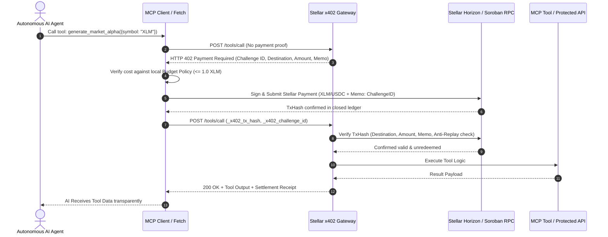

# `stellar-x402-mcp`

> **Stellar Agent Gateway & HTTP 402 Micropayment Facilitator for Model Context Protocol (MCP)**

[](https://github.com/camesenin/stellar-x402-mcp/actions/workflows/ci.yml)
[](https://opensource.org/licenses/Apache-2.0)
[](https://soroban.stellar.org/)
[](https://modelcontextprotocol.io/)

Autonomous AI agents (running on Claude Desktop, Cursor, Antigravity, or custom LLM frameworks) cannot easily use traditional credit cards or monthly SaaS subscriptions to pay for API resources, live compute, and agent tools. 

`stellar-x402-mcp` is developer infrastructure that brings machine-to-machine micropayments to life using **HTTP 402 Payment Required** and **Stellar / Soroban**.

---

## ⚡ Why Stellar for Autonomous Agent Payments?

| Feature | Stellar / Soroban | Ethereum L1 / L2 | Credit Cards / Stripe |
| :--- | :--- | :--- | :--- |
| **Transaction Cost** | **~$0.00001 (100 stroops)** | $0.05 – $5.00+ | $0.30 + 2.9% minimum |
| **Settlement Finality** | **3 – 5 seconds** | 12s – 15m | 2 – 3 business days |
| **Native Anti-Replay** | **Ledger Memos & Soroban Nonces** | Calldata inspection | Manual authorization ID |
| **Micro-denomination** | **Sub-cent fractions viable** | Impractical due to gas | $0.50 minimum charge |
| **Zero-KYC Machine Auth** | **Native Keypairs** | Smart Accounts / Bundlers | Requires corporate entity |

---

## 🏗️ Architecture



---

## 📦 Monorepo Structure

```
stellar-x402-mcp/
├── packages/
│   ├── contracts/   # Soroban Rust smart contract (ReceiptVault with anti-replay)
│   ├── gateway/     # Express middleware & MCP Server with 402 enforcement
│   ├── client/      # Autonomous Agent SDK with automated 402 budget negotiation
│   └── cli/         # `x402-stellar` CLI: keygen, gateway, verify, pay
├── examples/
│   └── mcp-payment-demo/ # Full end-to-end runnable agent payment simulation
└── .github/workflows/ci.yml # Continuous Integration (Contracts + TS)
```

---

## 🚀 Quickstart

### 1. Installation

```bash
git clone https://github.com/camesenin/stellar-x402-mcp.git
cd stellar-x402-mcp
pnpm install
pnpm build
```

### 2. Generate and Fund Agent Keypair (Testnet)

```bash
pnpm --filter @stellar-x402/cli run build
node packages/cli/dist/bin.js keygen --fund
```

Output:
```
✨ New Stellar Keypair Generated:
Public Key:  GAUTONOMOUS...
Secret Key:  SSECRETKEY...
✓ Friendbot funded account successfully with 10,000 XLM!
```

### 3. Run the x402 Gateway

Start an HTTP & MCP gateway protecting resources with a fee of `0.01 XLM`:

```bash
node packages/cli/dist/bin.js gateway \
  --port 3402 \
  --dest GA25XQA6A4QGWU566XN6ZCFW3OFH55YOOXWXUYUL2FJ5SO2R6GCCSVKV \
  --amount 0.01 \
  --network testnet
```

### 4. Use the Client in Your Agent Code

```typescript
import { createX402Fetch, ClientConfig } from '@stellar-x402/client';

const config: ClientConfig = {
  secretKey: process.env.STELLAR_AGENT_SECRET!,
  network: 'testnet',
  maxPaymentPerCallXlm: 0.5, // Safety ceiling per call
  totalBudgetLimitXlm: 10.0, // Maximum total spend
};

// Drop-in fetch replacement with automatic Stellar 402 payment handling
const agentFetch = createX402Fetch(config);

// First call gets 402, automatically signs payment, and returns 200 payload
const response = await agentFetch('http://localhost:3402/api/protected-intel');
const data = await response.json();
console.log('Result:', data);
```

### 5. Run the MCP Tool Payment Demo

```bash
pnpm --filter mcp-payment-demo test
```

---

## 🔒 Deployed Soroban Smart Contract (`X402PaymentVault`)

The repository includes a compiled and **on-chain deployed Soroban smart contract** on Stellar Testnet designed for verifiable audit trails and atomic token transfers:

- **Network**: Stellar Testnet
- **Contract ID**: [`CDCTANWGJPZ3YUYAP7NGS4ZHESA37YJEEQCHOOTINTVINOFNO5G24NIA`](https://stellar.expert/explorer/testnet/contract/CDCTANWGJPZ3YUYAP7NGS4ZHESA37YJEEQCHOOTINTVINOFNO5G24NIA)
- **Wasm Hash**: `a3e512cc196ff88ac2e2df83b19bac5415b9a89a569f03a881f65b5a4d91fbd5`
- **Instantiation Ledger**: `5526238` (TxHash: `ae152d8104b4e4b8bd100498f7e6245cbd68aecea88eaf5f165f4fc4f7a6e7be`)

### Contract Functions:
- `settle_payment(env, payer, recipient, token, amount, challenge_hash) -> Result<PaymentReceipt, X402Error>`
- `is_settled(env, challenge_hash) -> bool`
- `get_receipt(env, challenge_hash) -> Result<PaymentReceipt, X402Error>`
- `total_settlements(env) -> u64`
- **Features**:
  - Cryptographic anti-replay guarantee preventing duplicate challenge claims.
  - Emits `(settle, payer, recipient)` contract event for real-time indexing.
  - Sub-15KB optimized release build (`stellar_x402_contracts.wasm`).

### Build and Test Contracts

```bash
cd packages/contracts
cargo test
cargo build --target wasm32-unknown-unknown --release
```

---

## 🧪 Testing

Run all unit and integration tests across both Rust contracts and TypeScript packages:

```bash
pnpm test
cargo test --manifest-path packages/contracts/Cargo.toml
```

All 17 tests pass with zero warnings.

---

## 📄 License

Licensed under the [Apache License, Version 2.0](LICENSE).
Copyright 2026 Carlos Murillo (`camesenin`).
